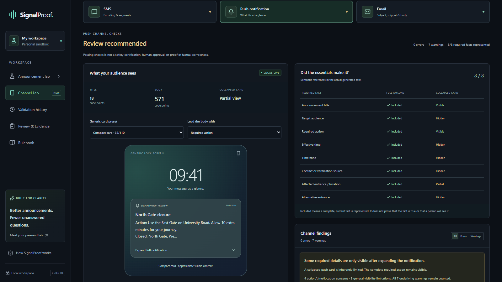
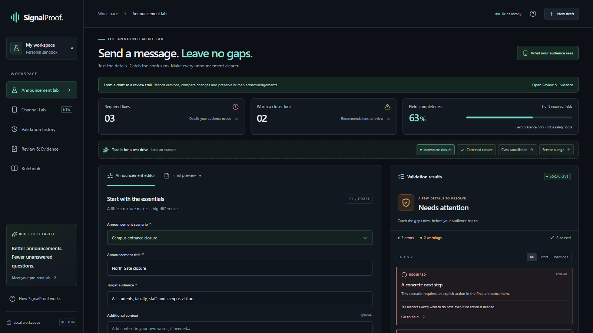
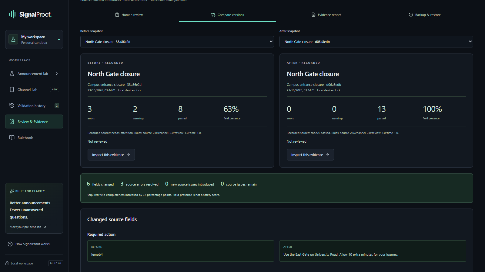

# SignalProof

**One message. Three realities.**

A pre-send lab for important announcements, built for **LaunchPad Hacks 2026**. Catch missing facts, inspect what SMS, push and email previews actually reveal, and preserve the checks and human responses behind a revision.

**Everything is processed in your browser. No real messages are sent.**

[Try the live application](https://hizmali.github.io/SignalProof/) · [Watch the 2:50 demo](https://www.youtube.com/watch?v=WSou-0mDPkg) · [GitHub repository](https://github.com/HIZMALI/SignalProof)



## The problem

A closure notice can contain the right details yet hide its alternative entrance in a collapsed notification. Source completeness and what a reader sees are different questions. SignalProof makes that difference visible before publication.

## What it does

| Layer | What you learn |
| --- | --- |
| **Source completeness** | Explainable rules flag missing or invalid structured facts, with links to the field to fix. Passing checks does not verify truth. |
| **Channel visibility** | SMS encoding/segment estimates, collapsed push coverage and email subject/snippet/body views show how one source changes across channels. Generic previews are simulations. |
| **Human self-attestation** | Explicit checklists and warning acknowledgements record a person's supplied responses against exact content. Identity and authority remain unverified. |

- Three scenarios: campus entrance closure, class/event cancellation and service outage.
- One source updates all three channel representations, with separate findings and fact coverage.
- Explicit IANA time zones, rejected DST gaps and consciously selected repeated times; legacy fixed offsets remain supported.
- Browser-local snapshots, before/after comparisons and exact-content review binding. Editing reviewed content requires re-review.
- Plain-text/JSON downloads, validated evidence backup/restore and a printable evidence report.
- Responsive layouts, keyboard controls and reduced-motion support.

## Screenshots

Real production captures with fictional built-in data; no human review has been fabricated.

| Missing information | Before and after |
| --- | --- |
|  |  |

[Evidence report](docs/release-assets/04-evidence-report-desktop.png) · [Mobile push](docs/release-assets/05-push-simulation-mobile.png) · [Mobile report](docs/release-assets/06-evidence-report-mobile.png) · [Asset notes](docs/release-assets/README.md)

## Try the story in two minutes

1. Load **Incomplete closure**: inspect three errors and two warnings; follow a finding to its source field.
2. Load **Corrected closure**, then open **Channel Lab**: the source passes, while SMS and collapsed push still need attention. Expand the push card to contrast full inclusion and visible content.
3. Open **Review & Evidence → Create two demo snapshots**: compare the same examples evaluated by the real engine.
4. Open **Human review**: inspect the checklist and warning requirements. Completion is self-attestation, not official approval.
5. Open **Evidence report**: export the JSON or print the record. History stays in this browser unless you export it.

Example dates are illustrative; contacts use reserved `.example` domains.

## Technology

React 19 · TypeScript strict mode · Vite 8 · Tailwind CSS 4 · Lucide · Temporal polyfill · Vitest / Testing Library · Playwright / axe. A static frontend with no backend, accounts, delivery service, analytics or runtime AI API.

## Run locally

Use Node.js **22.12+** and npm. The deployment workflow uses Node 22; local release checks were run with Node 24.

```sh
npm ci
npm run dev
```

Open the URL Vite prints (normally `http://127.0.0.1:4173/`). For a production preview, run `npm run build`, then `npm run preview`. On Windows, stop this project's dev/preview processes before reinstalling dependencies to release native module locks.

## Automated testing

```sh
npm test
npm run typecheck
npm run build
npm audit
npm run browsers:install
npm run test:e2e
npm run test:pages
npm run test:live
npm run verify:release-build
```

Unit/integration coverage: **234 passing tests**. The established production browser suite passes **25 cases**, with **2 explicit Chromium-only PDF skips**. The separate local Pages smoke suite passes **6 cases** across Edge, Firefox and WebKit. The deployed HTTPS site passes **9 live checks** across the same engines. See [verification details and manual gaps](docs/QA.md).

Local browser suites require installed **Microsoft Edge** plus Playwright Firefox/WebKit. `browsers:install` downloads only Firefox/WebKit to the ignored project folder. On Windows it requires a non-C: destination; set `PLAYWRIGHT_BROWSERS_PATH` if the checkout is on C:. Linux may also require Playwright system dependencies. CI separately installs Chromium with system dependencies and runs the Pages smoke suite; it does not claim to run the entire local three-engine suite.

`build:pages` sets `/SignalProof/` explicitly; ordinary `build` retains relative assets for local/static previews. `test:pages` serves **only** that subpath, then tests assets, hash navigation, reload, storage, channels, evidence and real downloads. `test:live` exercises the actual public HTTPS site using isolated browser contexts and fictional data. `verify:release-build` compares two Pages builds byte for byte. The [workflow](.github/workflows/pages.yml) builds on Node 22 and uploads only `dist/`.

## Architecture

`src/domain/` contains deterministic source rules, channel generation/coverage and evidence/review contracts. `src/components/` presents those results. `src/lib/` validates versioned LocalStorage and manages exports; `App.tsx` coordinates the single draft and hash navigation. Recorded snapshots retain their original rules/results. Restoring rechecks a working copy; it does not rewrite historical evidence.

No network is needed for processing after the static application loads. Initial loading/reloading still needs the site files: there is no installable offline service worker. Named-zone resolution uses the browser's Intl database, so future database updates may change recomputation.

## Privacy and human review

Drafts, snapshots and recorded responses stay in this browser's LocalStorage. They are **not shared between devices**, encrypted storage, a durable backup or an authenticated audit log. Avoid confidential data on shared devices and inspect exports before sharing them.

Rules check presence and basic format. They cannot establish factual accuracy, contact reachability, physical accessibility, sender authority, real-device rendering or delivery. Device-clock timestamps and local fingerprints are not signatures. Self-attestation never authorizes an emergency alert or certifies safety.

## Hackathon and attribution

Built for **LaunchPad Hacks 2026**.

**Project license: not selected.** Dependencies retain their own licenses: [attribution and license inventory](docs/THIRD-PARTY.md), [shipped notices](public/third-party-notices.txt).

## Documentation

[Channels](docs/CHANNELS.md) · [Review, time zones & evidence](docs/REVIEW-EVIDENCE.md) · [Testing](docs/QA.md) · [Screenshots](docs/release-assets/README.md) · [Third-party attribution](docs/THIRD-PARTY.md)
